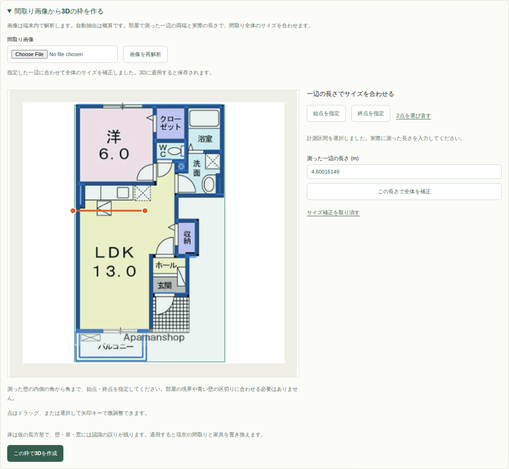
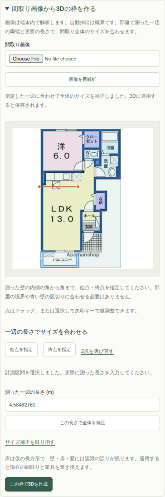
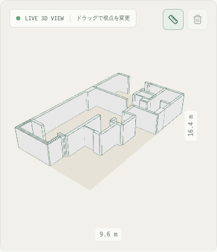

# 一辺の実測値で間取り全体のサイズを合わせるための調査

後続の実装では、部屋境界の認識を必須にせず、任意の2点と一辺の実測値で補正する方式を採用した。取り込み画面の個別編集・1/n表示を撤去し、端点のドラッグ・キーボード調整・補正の取消を追加した。交点への自動吸着と3D壁面の選択は未導入で、図面上の2点を使う。以下は実装前の比較記録。最新の操作は[README](../README.md)を参照する。

調査日: 2026-11-10。基準: `b676ca6` / Issue #28。今回の依頼に合わせ、取り込み画面の編集操作を簡素化し、一部屋の一辺の実測値から平面の比率を保って実寸へ合わせる方法を調べた。

## 結論

**「壁を選択 → 計測する区間を強調 → 端点2つを必要に応じて調整 → 実測値を入力」を第一候補とする。** 壁・壁面・計測線を分けて扱い、交点は端点を合わせる補助点にする。壁全体が1本でも、その一部分だけを測れるようにする。

交点で区切られた区間を自動で提示し、認識が不完全でも2点を利用者が直せる組合せがよい。部屋の完全な自動認識は、このサイズ合わせの必須条件にしない。これは一次資料と現在のコードに基づく設計判断であり、新UIや全6枚の選択操作を実装・検証した結果ではない。

## 今回の依頼で変更する方針

- 「壁を数値で追加」「空の枠から編集」は取り込み画面から外す。
- 全体幅・奥行き等を個別に数値変更する操作は、一辺の実測による比率を保つ補正へ置き換える。
- 「模型の表示倍率（1/n）」は外す。実寸モデルのサイズ合わせを主にする。
- 壁・床の詳細な形状編集は将来の2D図面モードへ集約する方向で設計する。端点・開口部等の既存フォームの削除範囲は、この役割分担に沿って整理する。

この文書は調査と変更方針の記録。現時点のUIから操作を削除したという意味ではない。READMEの現在の操作説明も、実装が変わるまで現行の内容を維持する。

## 現在のコードで起きること

[取り込みUI](../src/features/room-planner/components/floor-plan-importer.jsx)は選択した壁の`wallLength(wall)`全体を基準にする。長い壁が複数の部屋をまたいでいる場合、その一部屋分を入力すると全体の比率が間違う。個々の壁を認識する処理と、測る範囲の選択が同じ単位になっていることが問題。

現在のSVGには壁を選ぶ処理があるが、[3Dの壁](../src/features/room-planner/components/floor-plan-shell.jsx)には選択イベントがない。開口で分割された複数の箱も元の`wall.id`へ対応付けて選択できるようにする必要がある。

表示倍率は[画面](../src/features/room-planner/components/room-planner.jsx)・[hook](../src/features/room-planner/hooks/use-room-planner.js)・[Canvas](../src/features/room-planner/components/planner-canvas.jsx)・[viewport](../src/features/room-planner/components/planner-viewport.jsx)を通って`group scale`へ渡る。撤去時は見た目の選択欄に加え、この状態・props・変換も整理する。

## 方法の比較

| 方法 | 長い壁の一部を指定 | 認識ミスへの対応 | 導入上の判断 |
| --- | --- | --- | --- |
| 壁全体を選んで長さを入力 | できない | 長い壁・分割壁に依存 | 今の問題が残る |
| 交点で壁データを分割する | できる場合がある | 交点欠落・誤接続に弱い | 将来の2D編集の構造として検討。サイズ合わせには必須でない |
| 部屋を自動認識し、その一辺を選ぶ | 部屋が正しければ分かりやすい | 扉・開口・壁の欠落に影響される | 現段階の唯一の選択方法にはしない |
| 画像上の任意の2点＋実測値 | できる | 自動認識に依存しない | 最小の基準合わせとして有力。細い壁は選択補助が欲しい |
| 壁選択＋仮の区間分割＋動かせる2点 | できる | 自動区間を修正できる | 推奨。交点を利用しつつ、計測だけは継続できる |

2点の位置合わせは実在する方式。[Sweet Home 3Dの公式ガイド](https://www.sweethome3d.com/users-guide/)は、背景画像上の基準線の両端を既知の距離へ合わせ、実際の長さを入力して縮尺を設定する手順を説明している。この方式では、既知の長さが認識された壁全体と一致する必要はない。

[OpenLayersのスナップ例](https://openlayers.org/en/latest/examples/snap.html)は、辺・頂点・交点へ端点を合わせる操作の参考になる。[計測線を変更する例](https://openlayers.org/en/latest/examples/measure-style.html)も参考にした。今回は画面の振る舞いを参考にするもので、地図用ライブラリの導入や球面距離計算の採用を勧めるものではない。

## 交点の案をどう生かすか

交点は、長い壁のどこまでを測るかの候補として使える。ただし、交点があることと、部屋が判別できることは別である。

たとえば、一本の水平壁の上側がA室・B室、下側がC室で、AとBの仕切りがT字につながっている場合を考える。上側ではT字の位置が計測区間の境になるが、下側のC室では壁の端から端までが一辺となる。全ての交点で機械的に壁を分割すると、C室側も不要に分かれる。

したがって、交点は壁の両側で使い方を分ける。T字・十字・L字、壁の端点、近接しているだけの端点を区別し、選択した面に接する仕切りから区間候補を作る。自動区間が合わなければ、端点を動かして指定できるようにする。

扉・窓の端は、必ずしも部屋の境ではない。部屋の角から角まで測る場合は途中の開口も含められるようにする。逆に、壁が扉の前後で別々の線として認識されても、計測線はその隙間をまたいで置けるようにする。認識モデルへ新しい壁を足す必要はない。

### 交点での分割と部屋認識の違い

交点で線を分割する処理は一般にnodingと呼ばれる。[Shapelyのnode](https://shapely.readthedocs.io/en/stable/reference/shapely.node.html)は交点を線へ加えて、線が交点以外で交差しない状態にする処理を説明している。[polygonize](https://shapely.readthedocs.io/en/stable/reference/shapely.polygonize.html)は線から閉じた面を作るが、閉じない線からは面を得られない。

今回の図面は扉の開口や認識の欠落がある。閉じた面が得られても、収納・階段・設備の枠かもしれないため、それをそのまま部屋と確定しない。部屋推定のために一時的に入口を閉じる処理は、実際の3Dの壁から分ける必要がある。ShapelyはPythonライブラリで、今回のフロントへの直接導入候補ではない。

### 既存6モデルの交点を確認

前回の全6枚の製品モデル（`floor-plan-opening-experiment-assets/models/baseline-*.json`）に対し、変更を加えず線分の交点を計算した。各壁の途中にある交点のみを数え、端点同士・平行線・同一直線の重なりは含めない。交点の一致許容は線分パラメーター上で`1e-7`、平行判定の外積は`1e-8`とした。

| 図面 | 壁数 | 途中の交点を持つ壁数 | 壁ごとの途中の交点数の合計 |
| --- | --- | --- | --- |
| monochrome | 31 | 5 | 15 |
| colored（image1） | 41 | 17 | 22 |
| dark-background | 66 | 32 | 45 |
| textured | 68 | 33 | 69 |
| cottage | 30 | 20 | 25 |
| riverside | 109 | 34 | 51 |

壁ごとの合計なので、共有する交点が複数回含まれる場合がある。この表は、既存データから仮の計測区間を作れることの確認であり、部屋数・正しい部屋境の数・交点検出の精度ではない。認識された家具等の線も交点を作り得る。壁の太さの分だけ届かないT字の接続も、厳密な中心線交点の計算だけでは拾えない。

## 推奨する操作

1. 画像を取り込み、概算の3Dを表示する。
2. 「一辺の長さでサイズを合わせる」を開始し、測った壁の部屋側を選ぶ。
3. 選んだ壁面と、測る区間だけを色付けする。角・交点から端点候補を提示する。
4. 区間が違う場合は両端の点を動かす。細かい指定は小さい画像確認パネルで補助する。これはサイズ合わせ用の操作で、将来の全面的な2D編集モードとは責務を分ける。
5. 「この区間の実際の長さ」に1つの値を入力して、比率を保って全体を補正する。
6. 誤った区間や値なら、適用を取り消して指定し直せるようにする。

3Dで選択する場合は、壁の側面・元の壁ID・クリック位置を取得し、角や交点に近いときだけ候補へ合わせる。上面を押した場合や、表裏の区間が曖昧な場合は、強調表示で選択内容を確認できるようにする。

[React Three Fiberのイベント](https://r3f.docs.pmnd.rs/api/events)で壁のメッシュを選び、ヒット位置をモデル座標へ変換できる。背後の壁への伝播、視点ドラッグをクリックと誤認する問題、端点操作中のOrbitControlsの一時停止と復帰を確認する。画面上のタップ判定の広さはモデルのメートル値で固定しない。

壁を認識できない、壁が細かく切れている場合にも、画像上の2点から計測線を置ける経路を残す。復元後は元画像が保存されていないため、モデルの平面表示での指定か画像の再読込が必要になる。既存の保存仕様を勝手に画像保存へ変えない。

## 測るのは中心線か、内側の長さか

通常の利用者が部屋で測るのは、仕上げ面の内側の角から角までである。壁の中心線の交点から交点までとは、壁厚の分だけ違う。初期の候補点を中心線の交点に置いて、実測値をそのまま入れると補正値がずれることがある。

選択した壁面の線を壁厚の半分だけ中心線からずらし、接する壁の面との交点を内側の角の候補にする案がよい。仕切りとの接続は1つの中心点だけでなく、壁厚に対応する区間として扱える。認識された壁厚も概算なので、最終的には画像に合わせて端点を直せるようにする。

内部では、選択した壁IDと面、計測の2点、必要ならスナップ先を持つ。計測点を画像・平面の正規化座標として保持すれば、再度のサイズ合わせで基準点も同じ比率を保てる。2点が別々の壁片に乗るケースも許容し、同一の`wall.id`内だけに限定しない。壁IDや画像を差し替えたときは計測候補を破棄する。

## サイズ補正の計算と既存コードへの影響

現在のモデル上の計測区間の長さをL、入力した実測値をDとし、係数`k = D / L`を求める。2D上で横・奥行きを同じk倍にすれば、間取りの比率は保てる。

- 床の頂点、壁の端点、開口の幅・壁上の位置を同じ比率で補正する。
- 画像の線幅から推定した壁厚も、平面の比率を維持する方針なら補正対象になる。壁ごとの`thicknessRatio`は維持する。
- 一辺の水平距離から、壁高・窓の下端・開口の高さは推定できない。これらは別の仮定・既定値で管理し、平面の係数を自動でかけない。
- 面積表示は結果としてkの二乗に比例する。表示用の1/n変換は使わない。

現在の[resizeFloorPlan](../src/features/room-planner/utils/floor-plan.js)は、平面座標と開口の位置・幅を補正するが、壁の基準厚さは変えない。そのまま呼ぶだけで画像の線幅まで比例すると考えない。寸法合わせ専用の処理を分け、既存の一般的なリサイズ用途と混同しない。

計測点の距離がほぼ0、入力が不正、補正後のモデルが検証範囲外の場合は適用せず、直前の配置を保つ。現在の保存モデルは幅・奥行き1〜100m、基準壁厚0.05〜1m等の制約がある。黙って数値を丸めて、入力した実測値と違う縮尺にしない。

適用前の計測点は一時状態にし、確定した実寸モデルだけを既存の個人保存へ送る。同じ実測値を再適用したときに、古い基準の距離を使って二重に拡大しない。校正後も一辺を変更するたびに全体を均等に補正する。

[FramePlan](../src/features/room-planner/components/planner-viewport.jsx)は既に間取りの寸法変更でカメラと注視点を更新している。実寸が変わった後の再フレーミングへ利用できる。模型の表示倍率をカメラ操作に置き換えたと誤解させず、保存する実寸と画面の拡大表示を区別する。

## 将来の2D図面モードへのつなぎ方

計測区間は描画・選択用の派生データとして持ち、現段階で保存済みの壁を全て分割しない。既存の開口部は壁の始点からの距離で表現されているため、物理的に壁を分けるとID・開口の割当て・保存互換性まで扱う必要がある。

将来の2Dでは、頂点・接続関係・壁の両側の部屋・開口を持つ構造へ育て、今回の計測点や区間選択を再利用できる。壁を「構造の線」、部屋の一辺を「その片側で見える区間」、寸法を「任意の2点間の注記」として分ける考え方が合う。

最初の実装には新しい画像認識モデル・部屋検出ライブラリは必須でない。線分の交点と射影、近傍のスナップは既存のメートル座標で計算できる。画像の小さな隙間を一律に結合する処理は追加せず、候補の信頼度に応じて利用者が位置を確認できるようにする。

## 実装時の検証項目

- 1本の壁が複数の部屋をまたぐ場合、測る部分だけの長さを使える。
- T字の反対側では、交点をまたいで1辺を選べる。L字・十字・斜め壁・近接する別の壁でも誤った点へ強制しない。
- 内側の角と中心線、壁厚の異なる接続、扉で途切れる壁、交点が欠落した画像でも基準を置ける。
- 実測値による平面比率・壁厚・開口幅の補正と、高さを変えないことを検証する。
- ゼロ長・近すぎる2点・不正入力・範囲外・取り消し・やり直し・同じ値の再適用・保存と復元を確認する。
- 全6枚で、実際に一部屋の一辺を指定できるかをデスクトップ・モバイル幅で確認する。3Dの選択は実Canvasでカメラ操作との競合も検証する。
- 不要になったフォームと1/n選択のE2Eを新しいサイズ合わせのシナリオへ置き換える。単に古いテストを消して完了としない。

1辺による全体補正は、画像の縦横比が正しい平面図を前提とする。斜め撮影や縦横で違う倍率の画像の歪みまでは、この一回の入力では解決しない。短い区間ほど点の位置ずれの相対的な影響が大きいため、選べる範囲で長い一辺を基準にする案内と端点の拡大確認が有効。

## 今回の実施範囲

一次資料と現在のUI・モデル・保存・3D描画のコードを確認し、保存済みの6つのモデルで幾何学的な交点だけを調べた。新しい交点認識器、計測UI、部屋認識、操作の削除は未実装。変更は調査ドキュメントと参照リンクのみであり、本番ビルド・製品テスト・新UIのE2Eは実行していない。

## 実装後の操作と検証

取り込み画面は、画像の解析・計測用の2点・実測値・3Dへの適用に絞った。壁全体や部屋の境界を指定する必要はなく、図面上の任意の位置に始点と終点を置ける。端点のドラッグ、矢印キー、選び直し、直前のサイズ補正の取消に対応する。

`floor-plan-calibration.js`は正規化した2点の距離から平面を一様に補正する。壁厚・開口の位置と幅も補正し、壁高・窓下端・開口高は維持する。同じ値の再適用は変更扱いにせず、取消前の状態を失わない。無効な点・値・範囲外は適用しない。

計測点と補正途中の形状は一時状態で、「この枠で3Dを作成」を押したときだけ3Dと個人保存へ反映する。保存形式は第2版のまま。元画像・計測点は保存しない。既存の開口と床形状は引き続き読み込めるが、取り込み画面で個別の数値編集は行わない。

| 検証 | 結果 |
| --- | --- |
| `npm run test:unit --prefix frontend` | 9ファイル成功。区間の距離、比率、壁厚・開口・高さ、無効値、二重補正防止、保存復元を確認 |
| `npm run build --prefix frontend` | 成功。既存のチャンクサイズ警告あり |
| `npm run test:e2e --prefix frontend` | 全60件成功（UI48件、実WebGL12件）。全6枚のサイズ補正を検証 |
| `npm run test:floor-plan --prefix frontend` | 成功。既存の部分的な壁・開口・出っ張りの評価に新たなエラーなし |
| `git diff --check` | 成功 |

ブラウザでは、未適用の点操作・補正・取消が保存を変えないこと、端点のドラッグとポインターキャンセル、キーボード調整、範囲外の拒否、適用後の保存・再読込を確認した。実WebGLでも、補正後に描画が更新され、保存された実寸・壁厚が変わることを検証した。テストの補正係数は1.2で、実際の住宅の寸法精度を評価したものではない。CI上の実行と実機のタッチ操作は未確認。

### 実際の画面

以下は通常E2Eから保存した画像。区間と入力値は任意の2点による補正を確認するためのテスト用で、実際に測った部屋の一辺ではない。図面UIは実React・実OpenCVで動かし、3D画像は別の実WebGLプロジェクトから取得した。

| デスクトップ | モバイル幅 |
| --- | --- |
|  |  |

