# 扉・窓を壁と分けて検出するための調査

実装前の調査記録です。後続の[全6枚・8方式の実行検証](floor-plan-opening-experiments.md)に、認識と3Dの96画像・候補抽出と開口変換の結果・残る課題を記録しています。

調査日: 2026-11-09。基準: `023c70d` / Issue #28。AI・外部画像送信を使わず、現在のOpenCV.jsとフロントエンド内で実現する範囲を調べた。

## 結論

**壁の粗い位置と扉・窓の候補を別々に抽出し、位置関係を照合して開口部へ変換する構成を第一候補とする。** 円弧付き開き戸は「円弧＋扉板＋支点＋壁の隙間」、窓は「平行線の帯＋枠＋壁の連続性」を使う案がよい。これは調査に基づく設計判断であり、全6枚で精度改善を実証した製品実装ではない。

今回確認したことは、一次資料と公開コード、全6枚の原図の目視、使用中のOpenCV.jsのAPI、合成入力、全6枚の単純な円検出である。壁との照合・窓検出・開口部への自動変換は未実装。既存の壁認識器は変更していない。

## 現在の実装との差分

- [opencv-worker.js](../src/features/room-planner/utils/opencv-worker.js)の`openingBridge`は、細い線が太い壁の隙間を塞がないよう候補を抑制する処理。扉・窓の種類や幅を返す認識器ではない。
- [floor-plan-detection.js](../src/features/room-planner/utils/floor-plan-detection.js)は壁線を実寸モデルへ変換する。認識された開口部の自動割当てはない。
- [floor-plan.js](../src/features/room-planner/utils/floor-plan.js)は`door`・`window`の開口部を既に表現できる。`wallPieces`が壁を左右・腰壁・垂れ壁へ分割するため、3Dの穴あけを別のライブラリで作り直す必要はない。
- [floor-plan-image.js](../src/features/room-planner/utils/floor-plan-image.js)は長辺1024pxへ縮小した画素とプレビューだけを返し、元のImageBitmapを閉じる。原寸の部分画像を使う場合は、元画像の保持・切り出し・座標変換・後始末も変更する必要がある。

## 参考になる研究・実装

### 記号と壁の隙間を照合する研究

[Ahmedら: Improved Automatic Analysis of Architectural Floor Plans（ICDAR 2011、DFKI公式）](https://www.dfki.de/en/web/research/projects-and-publications/publication/5675)は、線の分離と記号認識を組み合わせる。扉テンプレートのSURFによる検出候補を壁の隙間と照合する部分が参考になる。[公式PDF](https://www.dfki.de/fileadmin/user_upload/import/5675_4520a864.pdf)

PDFの該当節は検索索引で確認したが、今回の直接取得はタイムアウトした。全文・図表の再確認や再現実験はしていない。公表された部屋認識の評価を、扉・窓の精度や今回の6枚の性能として引用しない。部屋領域を求めるために入口を閉じる操作は、部屋推定専用の画像に限定する必要がある。

### 公開コードから得られる点

| 対象 | 確認した内容 | 今回の使い方・制約 |
| --- | --- | --- |
| [FloorplanToBlender3d / detect.py](https://github.com/grebtsew/FloorplanToBlender3d/blob/master/FloorplanToBlenderLib/detect.py) | 扉モデルに対するORB特徴照合、位置・回転の推定、細部の矩形との照合 | 参照テンプレートと幾何の組合せの参考。小さい記号の特徴点不足、図柄依存を今回の画像で検証する必要がある |
| [Andrew50/door-detector](https://github.com/Andrew50/door-detector)・[選別手順](https://github.com/Andrew50/door-detector/blob/main/docs/door_selection_process.md) | ベクトルPDFの曲線へ円を当てはめ、角度・誤差・近傍の扉板で候補を選び、重複を除く設計 | 円弧と扉板の整合条件が参考。PNG/JPEGにはベクトルの曲線情報がないため、先に画像から線・円弧を取り出す必要がある。任意の学習による再重み付けは今回の対象外 |
| [talal-ai/floorplan-vision / exact_tracer.py](https://github.com/talal-ai/floorplan-vision/blob/main/backend/exact_tracer.py) | 円・楕円・平行線・隙間の候補抽出を実コードで確認 | 比較用の単純な基準として参考。固定ピクセル範囲や仮の実寸換算、円候補に固定の開始・終了角を与える箇所がある。出力だけで開き方向の正解とは扱わない |

今回、この3実装を新たに全6枚で実行比較してはいない。過去のFloorplanToBlender3dの実行記録は[実装比較](floor-plan-implementation-comparison.md)を参照する。各リポジトリの性能の自己申告は採用根拠にしない。

FloorplanToBlender3dは既存調査でGPL-3.0表記を確認済み。他の2件は今回、移植対象としてのライセンス確認を完了していない。floorplan-visionはREADMEにMIT表記がある一方、案内先の`LICENSE`は取得時404だった。いずれもコードのコピー・依存追加は行っていない。

## 使用中のOpenCV.jsで使える機能

`@techstark/opencv-js@4.12.0-release.1`をNode.jsで初期化し、実際の公開APIを確認した。Python版の名前がそのまま使えるとは限らない。[確認結果JSON](floor-plan-opening-research-assets/api-probe.json)

| API | 確認結果 |
| --- | --- |
| `Canny`, `findContours`, `approxPolyDP`, `fitEllipse` | 関数あり。輪郭・曲線候補に利用できる |
| `HoughCircles`, `HoughLinesP` | 関数あり。円検出を実行。直線検出は既存Workerが使用 |
| `matchTemplate`, `minMaxLoc`, `distanceTransform`, `warpAffine` | 関数あり。テンプレート照合・距離画像・回転の候補 |
| `ORB`, `BFMatcher` | コンストラクターあり。生成・破棄を確認。特徴点照合全体の品質は未検証 |
| `ORB_create`, `BFMatcher_create` | 未公開。Python風の呼出しを移植できない |
| `SURF`, `SURF_create`, `xfeatures2d` | 未公開。DFKIの手順をそのまま実行できない |
| `createLineSegmentDetector`, `LineSegmentDetector` | 未公開。今回の配布版ではLSDの利用を前提にしない |

[OpenCVの円検出](https://docs.opencv.org/4.12.0/d3/de5/tutorial_js_houghcircles.html)、[直線検出](https://docs.opencv.org/4.12.0/d3/de6/tutorial_js_houghlines.html)、[輪郭の特徴](https://docs.opencv.org/4.12.0/dc/dcf/tutorial_js_contour_features.html)、[テンプレート照合](https://docs.opencv.org/4.12.0/d8/dd1/tutorial_js_template_matching.html)を参照した。これらは画像処理部品であり、扉・窓を意味で分類するSDKではない。

### 合成入力での確認

160×160pxの黒背景へ、中心(80,80)、半径35px、線幅2pxの白い円弧を`cv.ellipse`で描いた。`HoughCircles`を`dp=1, minDist=20, param1=100, param2=15, minRadius=25, maxRadius=45`で実行した。

| 描いた形 | 円候補 |
| --- | --- |
| 四分円（0〜90度） | 0 |
| 円全体（0〜360度） | 1 |

これは一組の入力・パラメーターでの診断。Houghで四分円を検出できない一般的な証明ではない。部分円弧への対応と、拾いやすくしたときの誤検出を併せて検証する必要がある。

## 全6枚の記号を目視した結果

追加2枚の[出典・利用条件](../e2e/fixtures/floor-plans/holdout/sources.json)は既存の記録を参照する。下表は原図の目視による観察で、扉・窓を全数注釈した正解データではない。種類を断定できないものは候補として扱う。

| 図面 | 観察した特徴 | 検出上の注意 |
| --- | --- | --- |
| monochrome | 玄関・トイレ等の破線の円弧、細い扉板、収納のV字形、下側の細い平行線 | 破線を連続した輪郭と仮定できない。水回りの曲線も多い |
| colored（image1） | 比較的明確な円弧、収納の折戸らしい記号、上・下側の細い開口枠 | 扉の線は太い壁より薄い。着色や文字が近接する |
| dark-background | 円弧、収納の折線、窓枠らしい平行線、家具・水回りの線 | 椅子・浴槽・植栽等が形状の競合候補になる |
| textured | 小さい扉・折戸らしい記号、木目、設備、細い枠が密集 | 画像が小さく、線の分離と記号の欠落が課題 |
| cottage | 青い斜めの扉板らしい線に円弧がなく、窓らしい淡色の帯が緑の壁の間にある | 円弧の存在を必須にすると取り逃がす。色の一律除外も避ける |
| riverside | 大きい原図を縮小した細部、開口枠、中央下の大きな曲線階段 | 階段を扉の円弧と誤認し得る。縮小後に失われた記号を推測で補わない |

## 円検出だけを全6枚で診断

円検出を扉検出と見なせるかを調べるため、同じ処理を全6枚へ適用した。これは既存Workerや前処理の採用比較とは別の、Node.js上の単純な対照実験である。

- Pillow 13でRGBAとして読み、長辺1024px以下へLANCZOSで縮小し、透明部分を白背景へ合成した。製品のCanvas縮小とは同一ではなく、Cottageの製品側の色救済処理も適用していない。
- OpenCV.jsでグレー化、3×3 GaussianBlur、`HoughCircles(HOUGH_GRADIENT)`を実行。
- 短辺をSとして`dp=1.2, minDist=max(12,round(S*.04)), param1=100, minRadius=max(5,round(S*.01)), maxRadius=round(S*.18)`。投票閾値`param2`だけ18・30・45で比較し、図面名による調整はしていない。
- オレンジの円と番号は生の円候補。扉数・検出精度・信頼確率を示さない。扉の正解との対応付けはしていない。

| 図面 | 閾値18 | 閾値30 | 閾値45 |
| --- | --- | --- | --- |
| monochrome | 239 | 70 | 16 |
| colored | 217 | 133 | 63 |
| dark-background | 450 | 296 | 117 |
| textured | 281 | 187 | 120 |
| cottage | 203 | 56 | 12 |
| riverside | 646 | 432 | 153 |

閾値45でも、CottageではBedroomなどの文字に円が付き、白黒図面では水回りに候補が集中して玄関の破線円弧を拾えていない。全6枚の重ね合わせを確認した範囲で、扉以外の円候補が多く残った。今回の3設定が最適という主張や、Houghを併用する方式全体が無効という結論ではない。

### 全画像の重ね合わせ（18ケース）

各画像はリンク先で原寸表示できる。[候補座標・全パラメーターのJSON](floor-plan-opening-research-assets/circle-probe.json)

| 図面 | 閾値18 | 閾値30 | 閾値45 |
| --- | --- | --- | --- |
| monochrome | 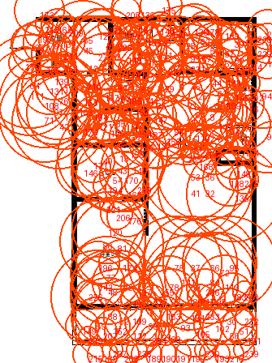 | 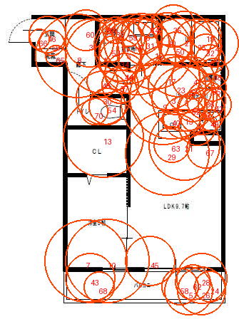 | 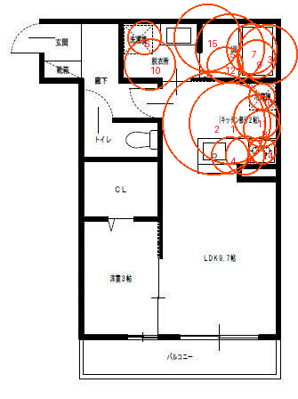 |
| colored | 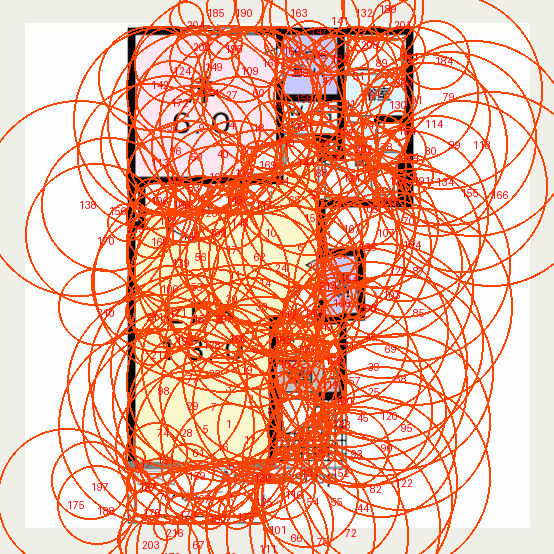 | 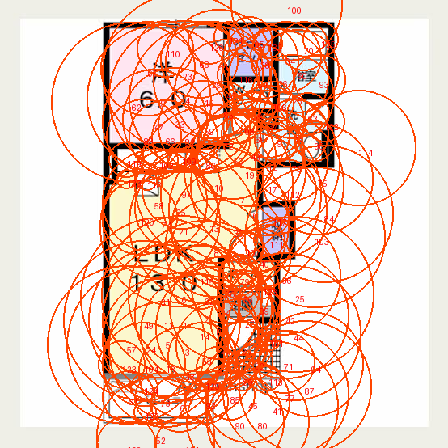 | 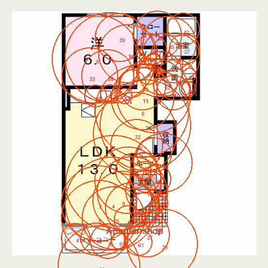 |
| dark-background | 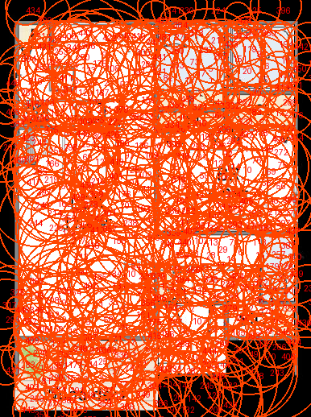 | 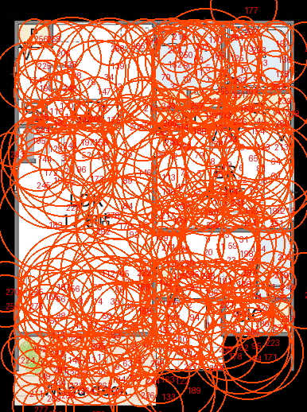 | 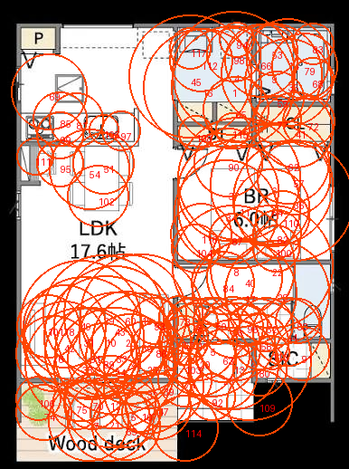 |
| textured | 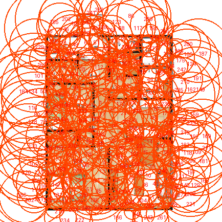 | 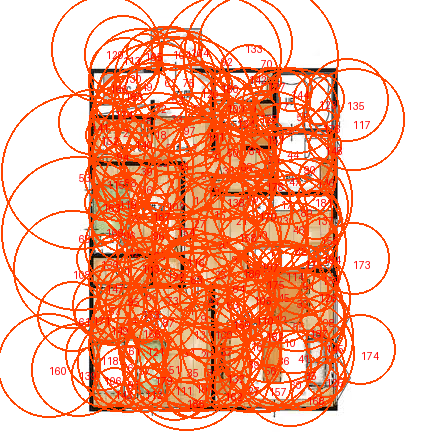 | 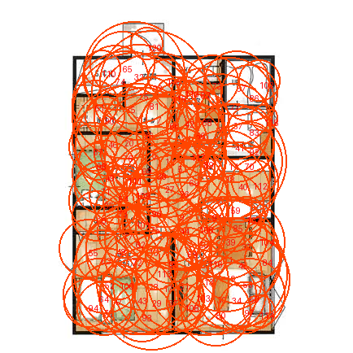 |
| cottage | 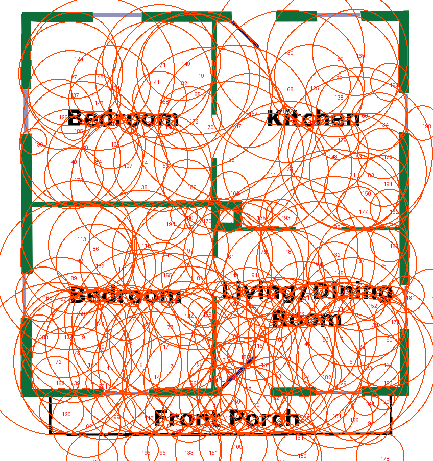 | 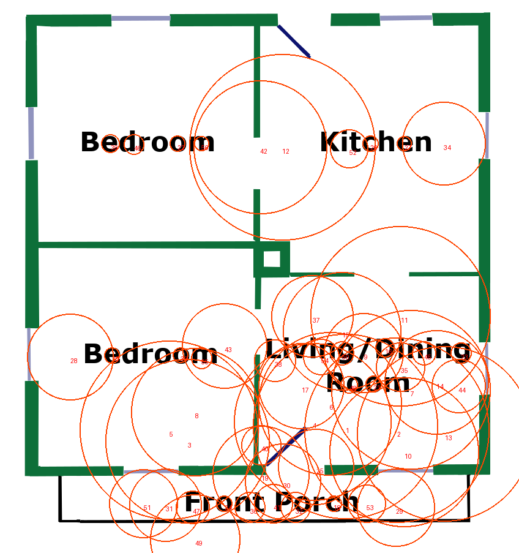 | 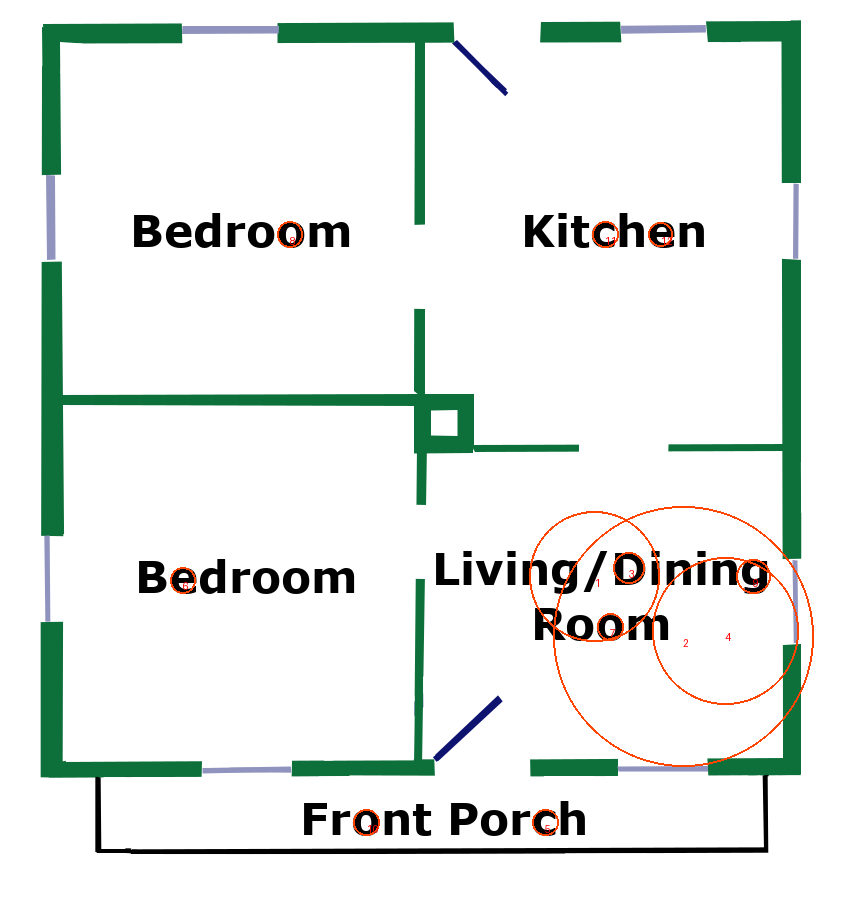 |
| riverside | 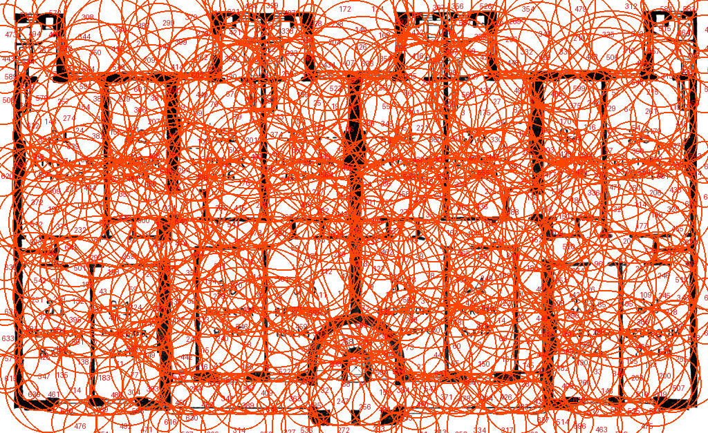 | 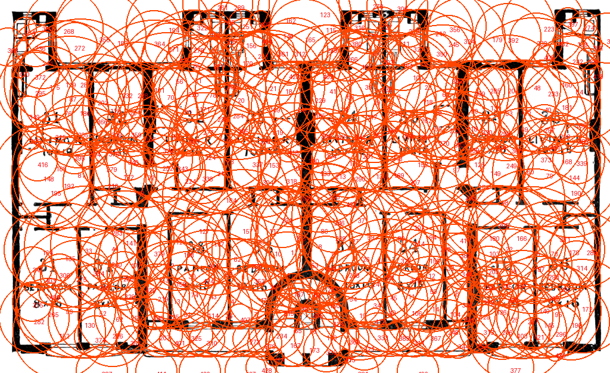 | 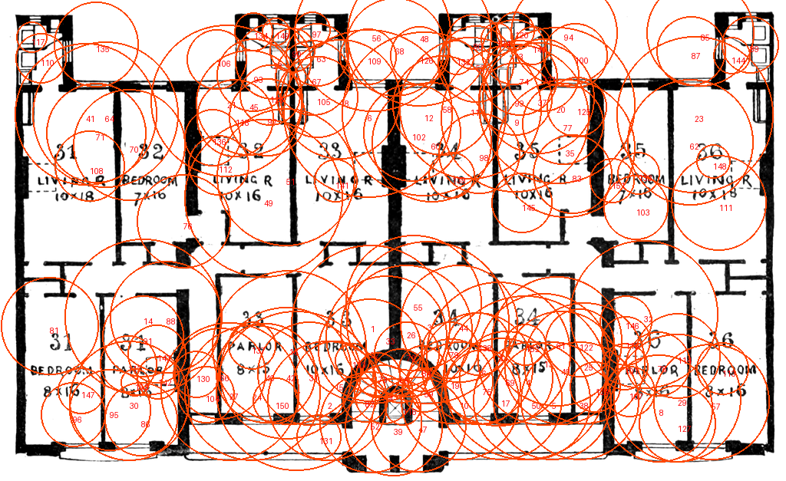 |

この診断では3Dモデルを生成・変更していないため、既存の3Dスクリーンショットを新しい検出器の結果として再掲しない。

## 第一候補の設計

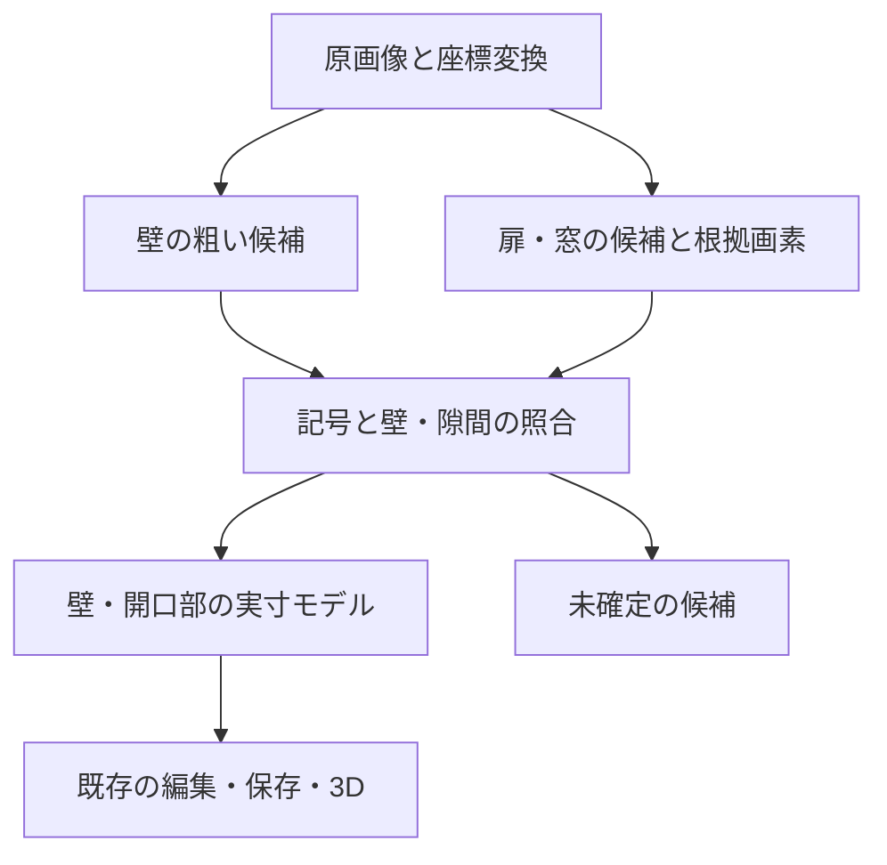

### 1. 記号を残す画像を別に持つ

太い壁の抽出用と、細線・色付き記号を残す画像を分ける。現在の壁向けの色除外・モルフォロジーの結果だけから扉・窓を探すと、必要な線が既に消えている可能性がある。元の画素と座標を保持し、二値化画像を共通の破壊的な書換えに使わない。

画像全域の粗い記号候補と、壁の粗い候補を先に得る。その後、壁の隙間と壁の帯の近傍へ詳しい照合を絞る。窓は細い枠で壁の間がつながっている場合もあるため、白い隙間だけを探索範囲にしない。

### 2. 円弧付き開き戸を最初に扱う

Canny等のエッジから曲線の部分列を取り、円の当てはめ誤差・角度範囲・画素の支持を確認する。RANSAC等の頑健な当てはめは候補で、今回未実装。壁や文字と接続した輪郭全体へ`fitEllipse`を一度当てるだけでは、扉の円弧を切り出せない。

円弧の中心近くに扉板の端があり、扉板の長さが円弧の半径に整合し、支点が壁端や戸当たりに接することを確認する。破線では角度方向の支持を区間ごとに見て、線が描かれていない角度も許容する。半径だけから開口幅を確定せず、壁の両端との対応から求める。

比較用には、自分たちで描いた円弧・扉板のテンプレートを回転・反転・複数倍率で照合する方法も用意できる。距離画像を使った照合は位置ずれに対応する候補。倍率や向きの探索コストがあるので、壁近傍へ範囲を制限して比較する。

### 3. 窓を独立して扱う

同方向で近接する平行線を集め、長さ・間隔・両端の枠・壁厚との関係を確認する。壁の両側に続く形状との整合を使い、棚・タイル・キッチンを窓へ分類しないようにする。平行線の本数だけでは確定しない。

単色の帯で描かれるCottageのような窓候補には、細線の窓とは別の根拠が必要。色は補助として保持し、特定の色を全図面共通の窓の定義にしない。

### 4. 円弧なしの扉・引き戸・折戸へ広げる

Cottageの斜線のような扉板候補は、片端の壁への接触と、対応する開口位置を使う。引き戸は平行線のずれと重なり、折戸は折線の並びと開口枠を手掛かりにする。家具・階段と似るため、最初から全種類を自動確定する範囲にはしない。種類が判別できない隙間は未確定候補として残す。

### 5. 壁モデルへ対応付ける

`recognizeFloorPlan`は現在`plan`と`engine`だけを返すため、Workerから候補を受け取る経路とImporterの一時状態が必要になる。

候補は画素座標・根拠・一致度を持つ解析時データとして管理し、確定したものだけ既存の`wall.openings`へ変換する。現行のモデルはフィールドを厳密に検証するので、`confidence`や`unknown`を保存済みモデルへ混ぜない。内部の一致度は正解確率ではない。

隙間の左右が別々の壁線になっている場合、候補を片方の短い壁へ割り当てるだけでは開口が範囲外になる。同一直線・厚さ・戸当たりの整合を確かめて、開口を持つ壁として表現し直す処理が必要になる。近接する別の壁・短い出っ張りを統合しないことを検証する。

幅・距離は最終的な壁端点・向きに対して射影し、重複・交点付近の曖昧さ・既存の開口との重なりを検証する。認識の箱全体を白く消したり、その範囲の壁を一律削除したりしない。手動編集済みの開口を後から候補で上書きしない。

## 画像だけでは確定できない事項

- 初期寸法は約8mという仮定なので、扉の幅を0.7〜1.2m等の実寸だけで足切りしない。まず円弧・扉板・壁厚の比や局所形状を使い、利用者の実寸補正後に物理寸法を評価する。
- 平面図の記号だけでは、窓の下端・高さや扉の上端は確定しない。3D用の仮値を明示し、既存の数値編集を使う。窓を床から天井までの穴として自動処理しない。
- 原寸の部分画像を使う改善は候補だが、失われた画素を補間拡大だけで取り戻したと扱わない。元画像の保持・縮小倍率・切り出し原点・メモリ解放まで設計する。
- 部屋の閉領域を求めるときに入口を一時的に閉じる画像は、最終的な壁支持画像と分ける。3D側へ閉鎖線を流さない。

## 次の試作と評価

1. 全6枚で、見分けられる扉・窓・種類不明の開口と、文字・浴槽・椅子・階段などの紛らわしい領域を注釈する。現在の`references.json`の開口点は穴が塞がれたかを見る部分注釈であり、記号の全数評価用ではない。
2. 壁処理は固定し、候補抽出だけを追加する。「円検出」「円弧＋扉板＋壁照合」「テンプレート＋壁照合」を同じ全6枚で比較する。図面ごとの閾値変更や利用者向けの感度選択は導入しない。
3. 最初は元の壁を変更せず、候補・支点・開口区間を別色で重ねる。候補本数に加えて、注釈との一対一対応による種類別の適合率・再現率、位置・幅の誤差、誤分類・重複を評価する。円弧の外接箱のIoUだけで開口位置の正解としない。
4. 開口への変換では「正しい壁を削った数」「必要な壁の欠落」「戸当たり・短辺の保持」を別に検証する。3Dの空白点と壁点を高さ別に確認し、窓の腰壁と上部の穴を分けて評価する。現行の評価関数は高さ0.5m固定なので、窓の穴の正解判定にそのまま流用できない。
5. 合成入力は左右・回転・破線・低解像度・開き角の違い、円弧なし、近接した複数扉、二重窓、短い壁、円形の家具、無地、不正な候補を含める。実ブラウザのWorkerで中止・タイムアウト・差し替え・Mat解放を確認する。
6. 改善が確認できた案だけを実寸モデルへ反映し、全6枚の認識・実3D、保存・復元・数値補正をデスクトップ／モバイル幅で確認する。既存の[前処理比較](floor-plan-preprocessing-experiments.md)を基準にし、図面ごとの悪化を平均で隠さない。

候補表示から始めるため、全種類を解決するまで既存機能を置き換える必要はない。新しいバックエンド実装はこの試作には不要。共有の形状対応は既存のBE-11 / #43で追跡し、未対応の共有を有効にしない。

## 今回の検証範囲

- 一次資料・公開コードと現在のコードを確認した。
- 全6枚の原図を目視し、全6枚×3設定の円候補をOpenCV.jsのNode.js実行で保存した。候補抽出の診断画像は18枚。
- OpenCV.jsの公開API、ORB/BFMatcherの生成・破棄、円・四分円の合成診断を実行した。実ブラウザWorkerの動作確認とは区別する。
- 扉・窓検出器の製品組込み、全数の正解注釈、適合率・再現率、3Dへの自動開口の確認、実機・CI検証は未実施。
- リポジトリの変更は調査文書と診断画像・JSONのみ。本番ビルドと製品テストの再実行は行っていない。過去の58E2E成功を今回の検出器の検証と扱わない。
